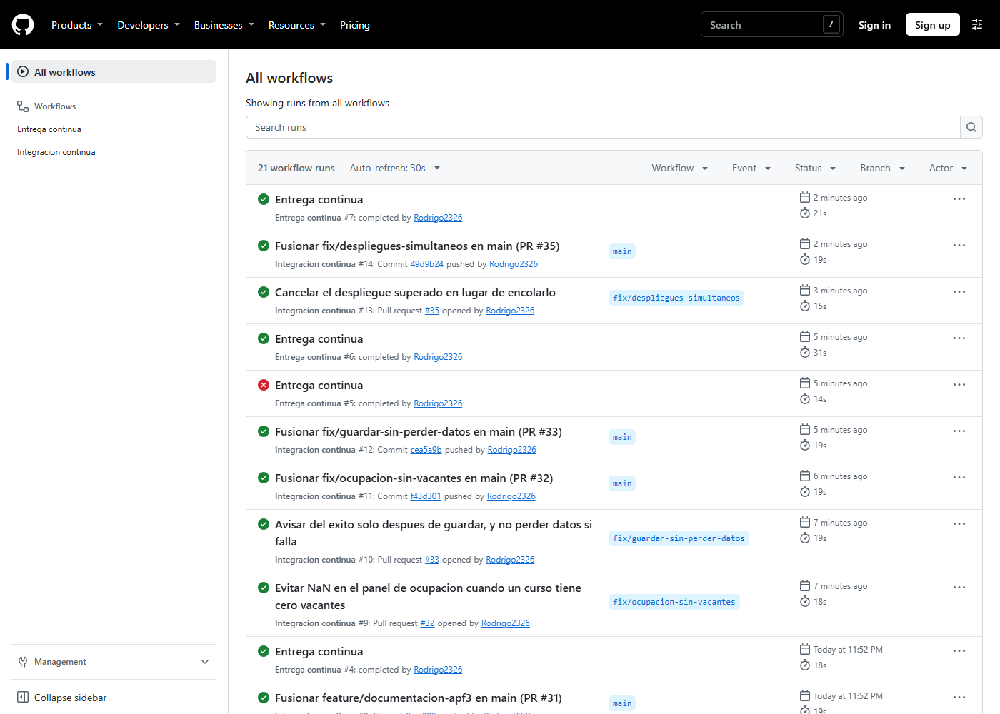
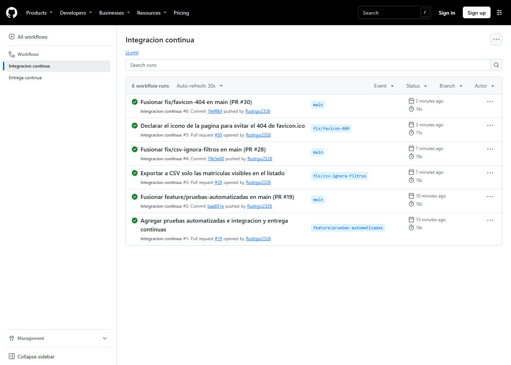
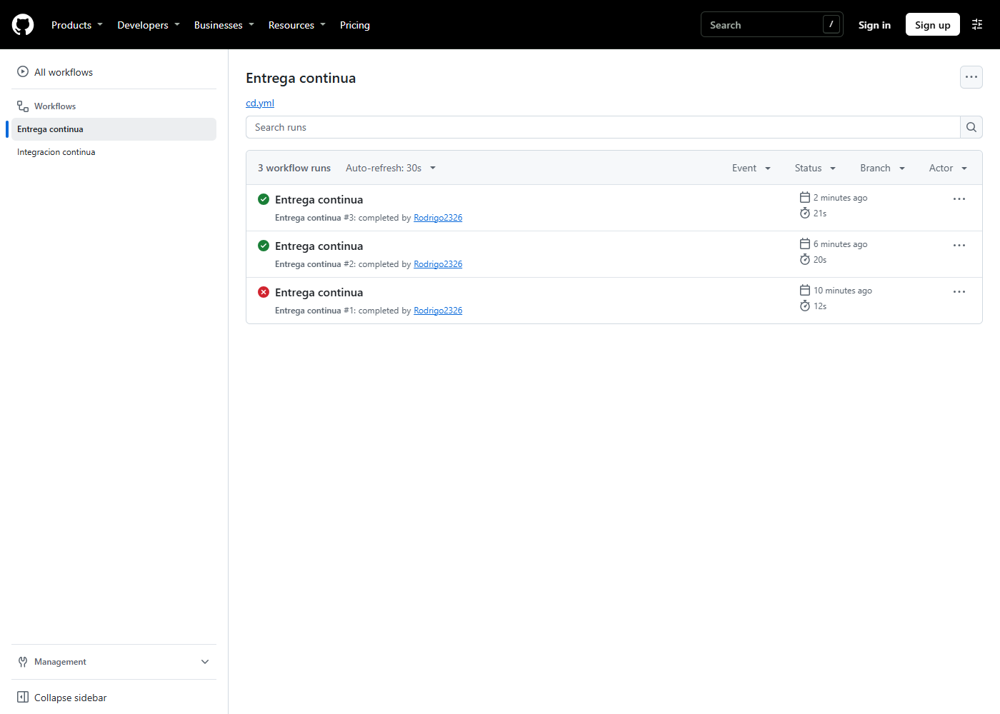
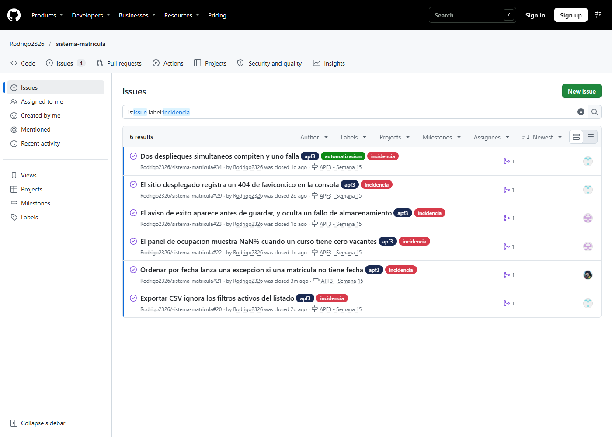
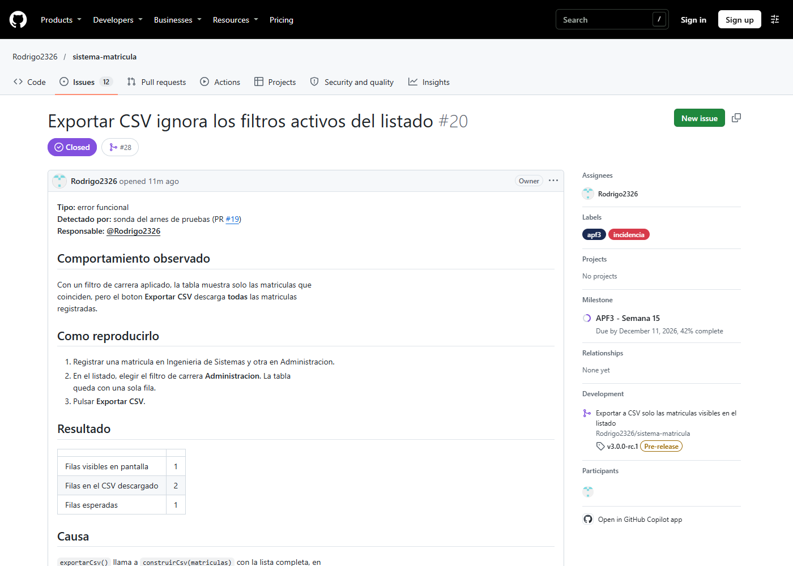
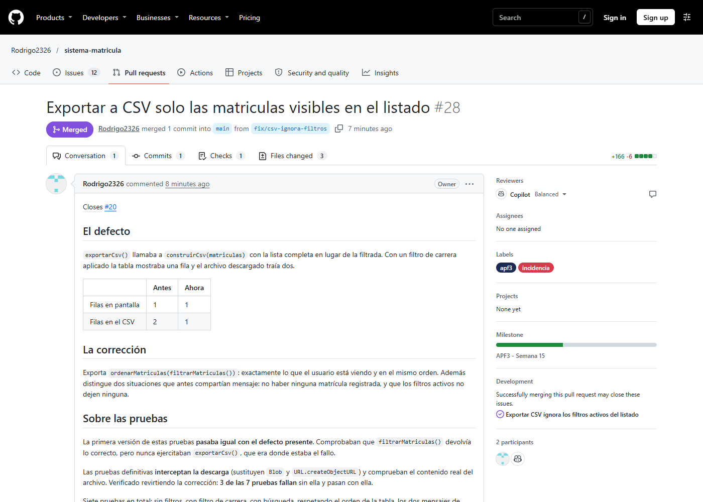
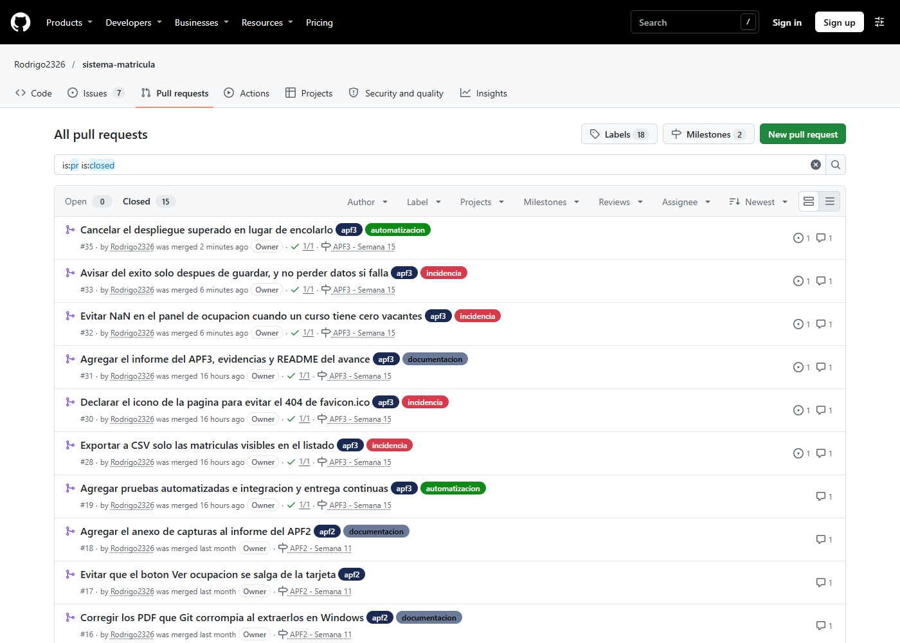
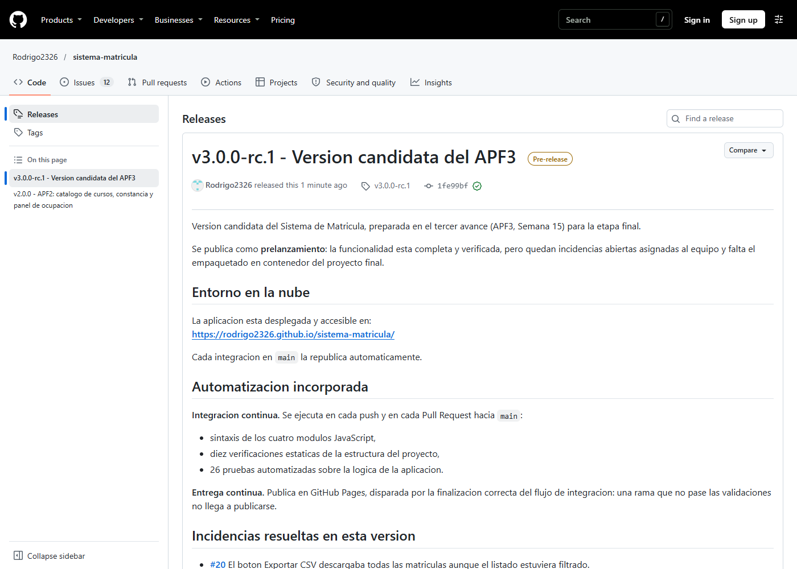
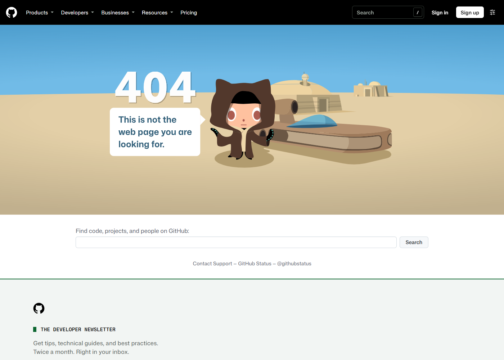

# Informe de Avance de Proyecto Final 3 (APF3)

**Curso:** Herramientas de Desarrollo (100000S66T)
**Periodo:** 2026-II
**Proyecto:** Sistema de Matrícula
**Repositorio:** https://github.com/Rodrigo2326/sistema-matricula
**Aplicación desplegada:** https://rodrigo2326.github.io/sistema-matricula/
**Versión candidata:** v3.0.0-rc.1
**Semana:** 15

---

## 1. Objetivo del avance

Los dos avances anteriores dejaron el proyecto versionado (APF1) y con un flujo
de colaboración trazable (APF2). En ambos, la comprobación de que la aplicación
seguía funcionando era manual: alguien abría el navegador y probaba.

Este tercer avance sustituye esa comprobación manual por una automática, y saca
el proyecto del escritorio de los integrantes. En concreto: se incorporó un
seguimiento formal de incidencias, un flujo de integración continua que valida
cada cambio antes de integrarlo, un flujo de entrega continua que publica la
aplicación, y un entorno en la nube donde cualquiera puede usarla.

A diferencia del APF2, **este avance no agregó funcionalidades**. Lo que cambió
es cómo se construye y se publica el producto.

## 2. Continuidad del proyecto

Se mantiene el mismo proyecto desde el APF1. La aplicación sigue siendo una
solución web para el registro y consulta de matrículas, con el catálogo de
cursos, la constancia imprimible y el panel de ocupación incorporados en el
avance anterior.

La continuidad es verificable en el historial: no hay carpetas paralelas ni
copias del proyecto, y la versión candidata de este avance desciende
directamente de la release `v2.0.0` del APF2.

## 3. Seguimiento de incidencias

### 3.1. Cómo se detectaron

Las incidencias de este avance no se inventaron para cumplir con el requisito:
salieron de someter la aplicación a casos que nadie había probado a mano,
usando el arnés de pruebas descrito en la sección 4.

Se registraron seis incidencias: cuatro las encontró el arnés de pruebas, una
la verificación del entorno desplegado y la última una revisión del propio
historial de ejecuciones del pipeline.

### 3.2. Lista de incidencias

| # | Incidencia | Tipo | Responsable | Estado |
| --- | --- | --- | --- | --- |
| 20 | Exportar CSV ignora los filtros activos del listado | Error funcional | Rodrigo Aparcana | Resuelta |
| 22 | El panel de ocupación muestra `NaN%` con cero vacantes | Error | Arnold Díaz | Resuelta |
| 23 | El aviso de éxito aparece antes de guardar | Robustez | Arnold Díaz | Resuelta |
| 29 | El sitio desplegado registra un 404 de `favicon.ico` | Error menor | Rodrigo Aparcana | Resuelta |
| 34 | Dos despliegues simultáneos compiten y uno falla | Error del pipeline | Rodrigo Aparcana | Resuelta |
| 21 | Ordenar por fecha lanza una excepción si falta el dato | Error | Giancarlo Ccahuana | Resuelta |

Cada incidencia incluye el comportamiento observado, los pasos para
reproducirla, la causa identificada en el código y sus criterios de
aceptación.

### 3.3. Detalle de las incidencias resueltas

**Incidencia #20 — Exportar CSV ignora los filtros activos.**

Con un filtro de carrera aplicado, la tabla mostraba las matrículas que
coincidían, pero el botón *Exportar CSV* descargaba todas las registradas. La
causa era que `exportarCsv()` llamaba a `construirCsv(matriculas)` con la lista
completa en lugar de la filtrada.

| | Antes | Después |
| --- | --- | --- |
| Filas visibles en pantalla | 1 | 1 |
| Filas en el CSV descargado | 2 | 1 |

Se corrigió exportando `ordenarMatriculas(filtrarMatriculas())`, es decir
exactamente lo que el usuario está viendo y en el mismo orden. De paso se
distinguieron dos situaciones que antes compartían mensaje: no haber ninguna
matrícula registrada, y que los filtros activos no dejen ninguna.

**Incidencia #29 — 404 de `favicon.ico` en el sitio desplegado.**

Al verificar el entorno en la nube, la consola del navegador mostraba un 404
permanente. El recurso era `/favicon.ico`, que el navegador pide por su cuenta
cuando la página no declara ningún icono. Importaba porque la demostración del
avance se hace sobre el entorno desplegado y con la consola abierta.

Se declaró el icono en línea como SVG en un *data URI*, reutilizando el mismo
birrete de la cabecera, de modo que no hizo falta sumar un archivo binario al
repositorio.

### 3.4. Las correcciones del responsable de calidad

Las incidencias **#22** y **#23** las corrigió Arnold Díaz.

En la **#22**, la corrección fue más allá de evitar la división por cero:
normaliza las vacantes y la ocupación comprobando que sean finitas y no
negativas, y acota el ancho de la barra entre 0 y 100. Eso cubre también
valores no numéricos, que es por donde podrían llegar datos de otra
procedencia desde el almacenamiento local.

En la **#23**, además de mover el aviso al final, agregó el **retroceso del
estado en memoria**: si el guardado falla, la lista vuelve a como estaba antes
del intento. Sin eso la matrícula habría quedado en la lista y en la tabla
aunque no se hubiera persistido, que es casi el mismo problema con otra cara.

**Un error en la prueba, y uno propio en la incidencia.** La prueba que
acompañaba a la #23 fallaba, pero no por culpa de la corrección: reemplazaba
`localStorage.setItem` sobre la instancia, y en jsdom esa asignación falla en
silencio. El almacenamiento seguía funcionando, la matrícula se guardaba y el
aviso de éxito aparecía con razón: la prueba comprobaba un escenario que nunca
llegaba a producirse. Para interceptarlo hay que sustituir
`Storage.prototype.setItem`.

Conviene declarar que **la reproducción original de la incidencia #23 tenía ese
mismo defecto**. El fallo era igualmente real —se ve leyendo el orden de las
llamadas en el código, con el aviso antes del guardado y sin captura de
errores— pero la evidencia adjunta no lo demostraba. Se corrigió al integrar, y
la prueba definitiva se verificó revirtiendo la corrección: dos de sus tres
casos fallan sin ella.

### 3.5. Una incidencia del propio pipeline

La incidencia **#34** no afectaba a la aplicación sino a la automatización. Al
integrar dos Pull Requests con ocho segundos de diferencia se dispararon dos
ejecuciones del flujo de entrega continua sobre el mismo commit. La segunda
publicó correctamente; la primera falló:

```
Found 0 artifact(s)
Error: No artifacts named "github-pages" were found for this workflow run.
```

El flujo declaraba `cancel-in-progress: false`, de modo que la segunda
ejecución esperaba en lugar de reemplazar a la primera. Las dos suben su propio
artefacto con el mismo nombre, y la que quedaba en espera se encontraba sin el
suyo al llegar al despliegue.

Se corrigió cancelando la ejecución superada en lugar de encolarla: publicar un
commit ya reemplazado no aporta nada, y una cancelación no ensucia el historial
como lo hace un fallo. El sitio nunca quedó mal publicado, pero el historial de
ejecuciones es una de las evidencias del avance.

### 3.6. La corrección del responsable funcional

La incidencia **#21** la corrigió Giancarlo Ccahuana.

El fallo era que `convertirFecha()` hacía `fechaStr.split('/')` sin comprobar
que el valor existiera: una matrícula sin fecha interrumpía el redibujado y el
listado dejaba de responder.

La corrección hace dos cosas. Primero, `convertirFecha()` devuelve `null` en
los tres modos de fallo posibles, no solo en el que aparecía en la incidencia:
valor ausente, formato con un número de partes distinto de tres, y fecha
sintácticamente correcta pero inválida. Segundo, y más importante, **decide**
dónde quedan esas matrículas: siempre al final, tanto en orden ascendente como
descendente, de modo que su posición sea predecible en lugar de depender del
algoritmo de ordenación.

Es la tercera incidencia del avance que se corrige yendo más allá del síntoma
descrito, lo que sugiere que escribir las incidencias con causa y criterios de
aceptación —en vez de solo con el error— cambió cómo se abordaron.

**Verificó que su prueba falla sin la corrección antes de abrir el Pull
Request**, y lo dejó escrito en el cuerpo: tres de sus cuatro casos fallan sin
ella. Fue el primero del equipo en hacerlo, después de que en este mismo avance
aparecieran dos pruebas —una de cada uno de los otros dos integrantes— que
pasaban igual con el defecto presente.

### 3.7. Relación entre una incidencia y el cambio que la resolvió

La cadena es trazable en los dos sentidos:

| Incidencia | Rama | Pull Request | Autor de la corrección |
| --- | --- | --- | --- |
| #20 | `fix/csv-ignora-filtros` | #28 | Rodrigo Aparcana |
| #21 | `fix/orden-fecha-sin-dato` | #37 | Giancarlo Ccahuana |
| #22 | `fix/ocupacion-sin-vacantes` | #32 | Arnold Díaz |
| #23 | `fix/guardar-sin-perder-datos` | #33 | Arnold Díaz |
| #29 | `fix/favicon-404` | #30 | Rodrigo Aparcana |
| #34 | `fix/despliegues-simultaneos` | #35 | Rodrigo Aparcana |

Cada Pull Request lleva `Closes #N` en su cuerpo, de modo que GitHub cerró la
incidencia al integrar y dejó el enlace en ambas direcciones. **Las seis
incidencias registradas en el avance quedaron resueltas.**

## 4. Pruebas automatizadas

### 4.1. El problema a resolver

Los módulos de `js/` son scripts clásicos: no exportan nada y tocan el DOM en
cuanto se cargan, asumiendo que `index.html` ya existe. No se pueden importar
desde un archivo de pruebas sin reescribirlos.

Reescribirlos habría sido un cambio grande y arriesgado a tres semanas de la
entrega final. En su lugar, el arnés de pruebas **levanta el `index.html` real
en un DOM simulado y le inyecta los módulos como etiquetas `<script>`**. La
ventaja añadida es que así se prueba el mismo HTML que se publica, no una copia
preparada para las pruebas.

### 4.2. Un detalle que costó encontrar

El primer intento ejecutaba los módulos con `ventana.eval(codigo)`. Las
funciones quedaban accesibles, pero el estado no: `ventana.matriculas` era
`undefined`.

La razón es que las declaraciones `let` y `const` del ámbito global **no
cuelgan de `window`**, a diferencia de `var` y de las funciones. Y en un *eval*
indirecto esas declaraciones van a un ámbito que se descarta al terminar la
llamada, de modo que las funciones seguían funcionando —cerraban sobre ese
ámbito— pero desde fuera no había forma de leer el estado.

Inyectar los módulos como etiquetas `<script>` resuelve las dos cosas: las
declaraciones quedan en el ámbito global de la ventana y el arnés puede
leerlas.

### 4.3. Qué cubren

Treinta y seis pruebas repartidas en cuatro archivos:

| Archivo | Pruebas | Qué cubre |
| --- | --- | --- |
| `matriculas.test.js` | 15 | Registro, validaciones, duplicados, vacantes y persistencia |
| `cursos.test.js` | 12 | Catálogo, edición de cursos y panel de ocupación |
| `exportacion.test.js` | 7 | Exportación a CSV, filtros, orden y escapado |
| `ordenamiento.test.js` | 4 | Ordenamiento por fecha con datos incompletos |

Entre ellas, las que cubren los dos defectos que la revisión del APF2 detectó:
que al renombrar un curso se actualicen las matrículas, y que dos cursos
homónimos en ciclos distintos no bloqueen una matrícula legítima.

### 4.4. Una prueba que no probaba nada

La primera versión de las pruebas de exportación **pasaba igual con el defecto
presente**. Comprobaban que `filtrarMatriculas()` devolvía la lista correcta,
pero nunca llegaban a ejecutar `exportarCsv()`, que era justamente donde estaba
el fallo.

Se detectó revirtiendo la corrección a propósito y comprobando que las pruebas
seguían en verde. Las pruebas definitivas **interceptan la descarga**
—sustituyen `Blob` y `URL.createObjectURL`— y verifican el contenido real del
archivo. Revirtiendo la corrección, tres de las siete fallan.

La lección es que una prueba que pasa con y sin el defecto es peor que no tener
prueba, porque da una confianza que no corresponde. Toda prueba de regresión
debería comprobarse haciéndola fallar al menos una vez.

### 4.5. Verificación estática

Además de las pruebas, el proyecto incluye diez comprobaciones estáticas sobre
cosas **que ya rompieron este proyecto al menos una vez**:

- Que las llaves de la hoja de estilos estén balanceadas y que ningún bloque
  quede anidado por error dentro de otra regla. En el APF2, una resolución de
  conflicto perdió una llave y dejó el panel de ocupación dentro de una regla
  `@media print`: las barras perdían el color en pantalla sin que se
  produjera ningún error.
- Que los módulos se carguen en orden de dependencia. `ocupacion.js` llegó a
  cargarse antes que `cursos.js`, del que depende.
- Que cada archivo referenciado desde `index.html` exista en el repositorio.

## 5. Integración continua

### 5.1. Configuración

El flujo está definido en `.github/workflows/ci.yml` y se ejecuta sobre
GitHub Actions en cada push y en cada Pull Request hacia `main`.

| Paso | Qué valida |
| --- | --- |
| Preparar Node.js | Versión 20, con caché de dependencias |
| Instalar dependencias | `npm ci` sobre el archivo de bloqueo |
| Sintaxis de los módulos | `node --check` sobre los cuatro archivos |
| Estructura del proyecto | Las diez comprobaciones estáticas |
| Pruebas automatizadas | Las 36 pruebas |

La configuración, resumida:

```yaml
on:
  push:
    branches: [main]
  pull_request:
    branches: [main]

jobs:
  validar:
    runs-on: ubuntu-latest
    steps:
      - uses: actions/checkout@v4
      - uses: actions/setup-node@v4
        with:
          node-version: '20'
          cache: npm
      - run: npm ci
      - run: npm run verificar:js
      - run: npm run verificar:estructura
      - run: npm test
```

Los tres pasos de validación son los mismos comandos que cualquier integrante
puede ejecutar en su equipo con `npm run verificar`. Esto es deliberado: si el
pipeline ejecutara algo distinto de lo que se puede correr en local, un fallo
en la nube sería difícil de reproducir.

### 5.2. Resultado

El pipeline se ejecuta en unos 15 a 20 segundos. Al cierre de este avance
acumula veintisiete ejecuciones entre los dos flujos, con el historial completo
disponible en la pestaña *Actions* del repositorio.

Dos de ellas aparecen en rojo y conviene explicarlas, porque ambas son reales y
se conservaron deliberadamente en lugar de borrarlas:

| Ejecución | Motivo | Desenlace |
| --- | --- | --- |
| Primer despliegue | GitHub Pages todavía no estaba habilitado | Corregido al habilitarlo |
| Despliegue duplicado | Dos integraciones en ocho segundos (incidencia #34) | Corregido en el PR #35 |

En ninguno de los dos casos llegó a publicarse una versión defectuosa, que es
justamente lo que el encadenamiento entre los dos flujos pretende evitar.

## 6. Entrega continua y plataforma en la nube

### 6.1. Configuración

El flujo está definido en `.github/workflows/cd.yml` y publica la aplicación en
**GitHub Pages**.

La decisión de diseño relevante es el disparador: el flujo **no** se dispara con
el push a `main`, sino con la **finalización correcta del flujo de integración
continua**. Si las validaciones fallan, no se publica nada. Disparar con el
push habría permitido publicar una versión que no pasa las pruebas.

El flujo prepara el sitio copiando únicamente lo que la aplicación necesita
—`index.html`, `css/` y `js/`—, de modo que ni las dependencias de prueba ni la
documentación interna llegan al servidor. Añade además un `VERSION.txt` con el
commit y la fecha de publicación, que permite comprobar desde fuera qué versión
está desplegada.

### 6.2. Entorno en la nube

La aplicación está accesible en:

**https://rodrigo2326.github.io/sistema-matricula/**

Verificación de los recursos publicados:

| Recurso | Respuesta |
| --- | --- |
| `/` | HTTP 200 |
| `/css/estilos.css` | HTTP 200 |
| `/js/app.js` | HTTP 200 |
| `/js/cursos.js` | HTTP 200 |
| `/js/constancia.js` | HTTP 200 |
| `/js/ocupacion.js` | HTTP 200 |
| `/VERSION.txt` | HTTP 200 |

La aplicación se probó directamente sobre el entorno desplegado: registro con
control de vacantes, panel de ocupación, constancia y su vista de impresión, y
los filtros del listado. Sin errores de consola.

## 7. Versión candidata

Con las validaciones en verde y la aplicación publicada se etiquetó la versión
candidata **v3.0.0-rc.1**, marcada como prelanzamiento.

Se publicó como prelanzamiento, y no como versión definitiva, por dos razones
que conviene declarar: quedan tres incidencias abiertas asignadas al equipo, y
falta el empaquetado en contenedor que corresponde al proyecto final.

## 8. Herramientas utilizadas y criterio de elección

| Necesidad | Herramienta | Por qué esta |
| --- | --- | --- |
| Pruebas | Runner de Node (`node --test`) | Viene incluido en Node 20: no agrega dependencias ni configuración al proyecto |
| DOM simulado | jsdom | Única dependencia de desarrollo; permite probar sin abrir un navegador |
| Integración y entrega continuas | GitHub Actions | Vive en el mismo repositorio, de modo que cada ejecución queda enlazada a su commit y a su Pull Request |
| Plataforma en la nube | GitHub Pages | La aplicación es estática y no necesita servidor; el despliegue se integra con Actions sin credenciales externas |
| Seguimiento de incidencias | GitHub Issues | Permite cerrar una incidencia desde el Pull Request que la resuelve, con el enlace en ambas direcciones |

El criterio común fue **no incorporar herramientas que el equipo no pueda
explicar**. El lineamiento advierte explícitamente contra presentar pipelines o
despliegues copiados, y una cadena con empaquetador, framework de pruebas y
servicio de despliegue externo habría sido más vistosa pero más difícil de
sostener en la sustentación.

Quedó deliberadamente fuera un analizador de estilo de código. Habría sido fácil
de añadir, pero sus avisos no son defectos, y el objetivo de este avance era que
una ejecución en rojo significara siempre que algo está roto.

## 9. Organización del equipo

| Integrante | Rol | Aporte en el APF3 |
| --- | --- | --- |
| Aparcana Mamani Rodrigo Alonso | Responsable de repositorio y documentación | Arnés de pruebas, verificación estática, pipelines de CI y CD, despliegue en la nube, incidencias #20, #29 y #34, versión candidata e informe |
| Ccahuana Huillca Giancarlo | Responsable funcional | Incidencia #21 resuelta, con su prueba de regresión verificada |
| Arnold Jhuncor Díaz Silva | Responsable de calidad y automatización | Incidencias #22 y #23 resueltas, con sus pruebas de regresión |

Hacia el final del avance, Arnold Díaz comunicó que no podría completar sus
tareas pendientes. Su aporte técnico ya integrado se mantiene —las incidencias
#22 y #23— y las tareas que quedaban a su nombre se reasignaron de forma
explícita: la verificación funcional pasó a Rodrigo Aparcana y la revisión de
los últimos Pull Requests a Giancarlo Ccahuana. El cambio de responsable quedó
registrado en las propias tarjetas, de modo que el historial del repositorio y
este informe digan lo mismo.

El reparto de este avance es deliberadamente desigual: la infraestructura de
automatización es una pieza única que no se puede partir en tres sin que las
partes se estorben. A cambio, las incidencias quedaron repartidas, y el
responsable de calidad asume la ampliación de la batería de pruebas, que es la
tarea que más crece de cara al proyecto final.

El equipo mantuvo la **reunión de coordinación diaria en Microsoft Teams, de
lunes a viernes de 10:00 a 10:30 horas**, establecida en el avance anterior.

## 10. Revisión de código entre integrantes

Los nueve Pull Requests del avance recibieron revisión. La del PR #2 en el
avance anterior ya había demostrado su utilidad; en este, cuatro observaciones
sobre líneas concretas apuntaron a defectos que seguían vivos:

| Pull Request | Observación | Desenlace |
| --- | --- | --- |
| #19 | El resumen del flujo de CI repetía `job.status` en las tres filas, de modo que un fallo en las pruebas marcaba también la sintaxis y la estructura | Corregido en el PR #39 |
| #28 | Al reutilizar `ordenarMatriculas()`, la exportación heredaba el fallo de la incidencia #21 | Cubierto al integrar el PR #37 |
| #32 | Un curso sin vacantes pero con matriculados está sobrepasado, y se mostraba como `3 / 0 (0%)` con la barra en verde | Corregido en el PR #39 |
| #35 | Cancelar un despliegue a Pages en curso puede cortarlo; la causa de fondo era el nombre repetido del artefacto | Anotado como deuda técnica |

La tercera es la más reveladora: la corrección de la incidencia #22 resolvió el
`NaN`, pero al devolver 0 % dejó **el caso más grave pintado como el más
tranquilo**. Un defecto introducido al corregir otro, que ni las pruebas ni la
verificación estática podían detectar, porque ambas comprueban que el código
hace lo que dice y no que lo que dice sea lo correcto.

La cuarta observación cuestionaba una decisión propia del pipeline y tenía
razón en los dos puntos. Se documenta como deuda técnica en lugar de
corregirse, porque hacer único el nombre del artefacto obligaría a sustituir
las dos acciones de Pages por llamadas manuales a la API.

## 11. Reflexión sobre la dinámica de trabajo

**La automatización cambió qué se discute en las reuniones.** Antes, buena
parte de la coordinación diaria se iba en confirmar que lo que cada uno había
subido no rompía lo de los demás. Con el pipeline validando cada Pull Request,
esa pregunta se responde sola y la reunión pasó a discutir decisiones.

**Las pruebas encontraron cosas que la revisión humana no.** Los dos defectos
del APF2 los encontró un compañero leyendo el código. Los cuatro de este avance
los encontró el arnés, probando casos que nadie habría probado a mano: un curso
con cero vacantes, una matrícula sin fecha, un almacenamiento que rechaza la
escritura. Las dos formas de revisión son complementarias, no sustitutas.

**Escribir la prueba después de la corrección es un riesgo.** El episodio de la
sección 4.4 —una prueba que pasaba con y sin el defecto— ocurrió precisamente
por escribirla después de corregir, cuando ya no había forma de verla fallar.
El hábito correcto es comprobar que la prueba falla antes de dar la corrección
por buena.

**Haber separado el CD del push fue acertado.** La primera ejecución del flujo
de entrega continua falló porque GitHub Pages todavía no estaba habilitado. Al
estar encadenado a la integración continua y no al push, ese fallo no dejó el
sitio en un estado intermedio: simplemente no publicó.

## 12. Verificación funcional sobre el entorno desplegado

Además de las pruebas automatizadas, se ejecutó una verificación manual de los
ocho casos definidos en la tarjeta #11, **sobre el entorno desplegado en la
nube** y no sobre una copia local, de modo que lo comprobado es exactamente lo
que recibe un usuario.

| # | Caso | Resultado |
| --- | --- | --- |
| 1 | Matricular hasta llenar el curso bloquea la plaza siguiente | Correcto |
| 2 | Editar una matrícula cuyo curso está lleno | Correcto |
| 3 | La constancia coincide con los datos de la fila | Correcto |
| 4 | Al imprimir la constancia no salen formularios ni botones | Correcto |
| 5 | El panel de ocupación coincide con el catálogo | Correcto |
| 6 | Eliminar una matrícula actualiza la ocupación y el panel | Correcto |
| 7 | Exportar CSV entrega solo las filas visibles | Correcto |
| 8 | Los datos persisten al recargar la página | Correcto |

Ocho de ocho, sin errores de consola ni peticiones fallidas. El caso 7 cubre
además la incidencia #20 sobre el entorno real.

Conviene precisar el alcance de este resultado: una verificación funcional
comprueba los casos previstos, no descubre los imprevistos. Los cuatro defectos
registrados como incidencias en este avance **no habrían aparecido en una
verificación como esta**: salieron de someter la aplicación a situaciones que
nadie prueba a mano, como un curso con cero vacantes o un almacenamiento que
rechaza la escritura. Las dos formas de comprobación son complementarias, y
presentar una como sustituto de la otra daría una confianza que no corresponde.

El detalle completo está en `docs/evidencias-apf2/verificacion-funcional.txt`.

## 13. Estado al cierre del avance

| Indicador | Valor |
| --- | --- |
| Incidencias registradas | 6 |
| Incidencias resueltas | **6** |
| Incidencias abiertas | 0 |
| Pruebas automatizadas | 36, todas en verde |
| Verificaciones estáticas | 10 |
| Ejecuciones del pipeline | 27, con 25 correctas |
| Versión candidata | `v3.0.0-rc.1` |
| Entorno en la nube | Operativo |

## 14. Conclusiones

El avance cumplió su objetivo. El proyecto pasó de depender de que alguien
recordara probar la aplicación, a validarse solo en cada cambio y publicarse
solo cuando esa validación pasa.

El resultado más útil no es el pipeline en sí, sino lo que encontró al
montarlo: cuatro defectos reales que llevaban semanas en el código sin que
nadie los notara, incluidos dos en funcionalidades que el equipo había dado por
terminadas y revisadas.

## 15. Próximos pasos (Proyecto Final)

- Resolver la deuda técnica del nombre del artefacto en el flujo de entrega
  continua, señalada en la revisión del PR #35.
- Empaquetar la aplicación en un contenedor e incluir su configuración en el
  repositorio.
- Desplegar la aplicación mediante una plataforma de ejecución de contenedores.
- Publicar la release final a partir de la versión candidata.
- Completar la documentación final: arquitectura, diagrama del flujo de
  trabajo, resumen de herramientas y lecciones aprendidas.

---

# Anexos

Las figuras de esta sección no cuentan para la extensión del informe.

## Anexo A. Automatización







## Anexo B. Seguimiento de incidencias









## Anexo C. Versión candidata y despliegue





## Anexo D. Salida de las validaciones

Resultado de `npm run verificar` sobre la versión candidata:

```
Verificacion de estructura: 10 comprobaciones correctas
  - Las llaves de css/estilos.css estan balanceadas
  - El bloque "Panel de ocupacion por curso" esta en el nivel superior
  - El bloque "Constancia de matricula" esta en el nivel superior
  - index.html carga los cuatro modulos
  - Los scripts se cargan en orden de dependencia
  - Existe el archivo css/estilos.css
  - Existe el archivo js/app.js
  - Existe el archivo js/cursos.js
  - Existe el archivo js/constancia.js
  - Existe el archivo js/ocupacion.js

tests 36
pass 36
fail 0
```

La salida completa está en `docs/evidencias-apf3/validaciones.txt`.
